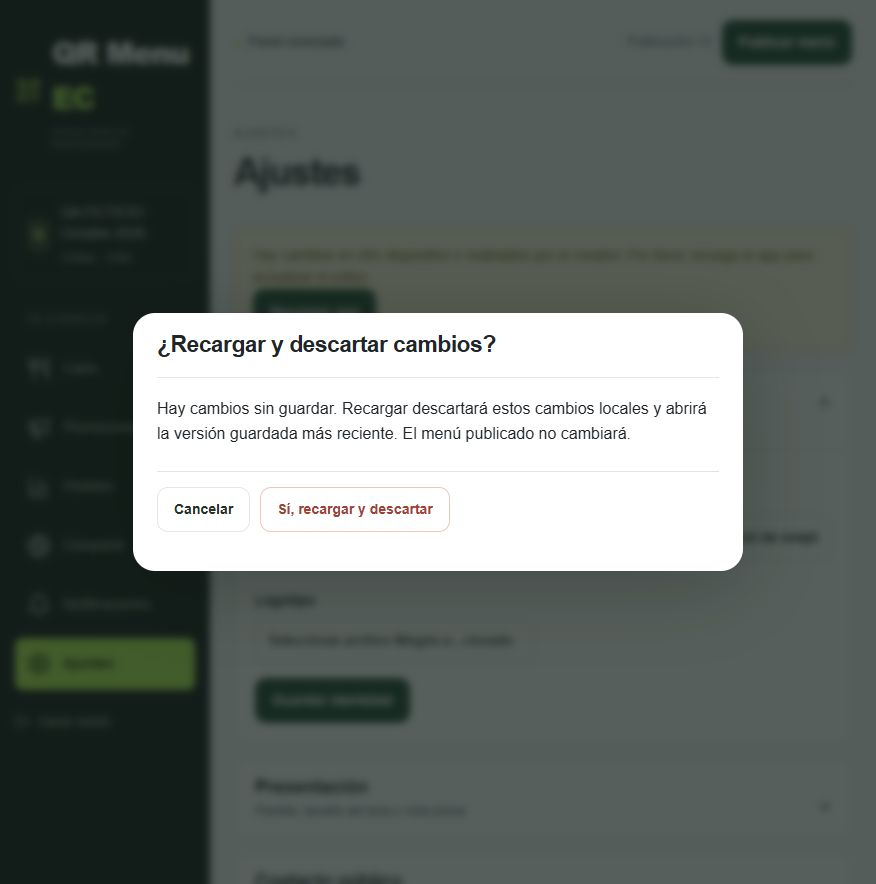

# Seguimiento de aceptación · 8 de octubre de 2026

Producción comprobada: **Worker `fb6cb9e4-53af-45f1-baa6-c2148988cce7`, tráfico 100 %**, código `f038ae04fe24eeabe0764132f73409e6ab881763` integrado por [PR 22](https://github.com/eslay07/qr-menu-ec/pull/22). [Plataforma](https://qr-menu-ec.consola.workers.dev) y [demostración ficticia](https://qa-ficticio-octubre-2026.consola.workers.dev/menu). El HTML y los archivos JS/CSS servidos coinciden con el build por SHA-256; el estado privado devuelve 401 sin sesión.

El flujo **Recargar app** utiliza una confirmación dentro del editor. En producción, con dos pestañas del dueño ficticio, Cancelar conservó el texto local; confirmar cargó el borrador guardado en la segunda pestaña. Esta comprobación cierra el bloqueo anterior de la confirmación nativa. La sesión se conservó. El texto temporal se retiró por Guardar borrador y la lectura operativa confirmó la limpieza; la publicación 13 permaneció intacta.

## Comprobaciones

| Alcance | Evidencia y resultado |
| --- | --- |
| Tipos y build final | Aprobados; entrada servida `index-BT0Z4pwv.js`. |
| Navegación/recarga local | 15/15 recorridos, incluido foco, Cancelar, Escape, contrato Volver Android, 409 y permisos del creador. APIs ficticias; no se atribuyen a Android físico. |
| API, D1 y diseño | 35/35 pruebas, sin fallos ni omisiones. El recibo resume la salida capturada de la herramienta; no inventa un log bruto. |
| Integración | Build, CodeQL, revisión de dependencias/secretos y preview aprobados antes de integrar PR 22. |
| Lint | 406 errores y 5 avisos históricos; cero diagnósticos nuevos al comparar multiplicidades con la base de 420 errores. Se resolvieron 14 históricos. **El lint global sigue sin aprobar**, sin desactivar reglas. |
| APK físico | Honor LNA-LX3, Android 16, WebView 153.0.8010.36. Instalado 0.8.4/código 15; extracción de solo lectura y SHA-256 idéntico al APK desplegado. |
| Distribución Android | APK y JSON 200, MIME correcto, metadatos `no-store`, hash y certificado conservados. No hubo nueva publicación Android en este seguimiento. |

[APK 0.8.4](https://qr-menu-ec.consola.workers.dev/downloads/qr-menu-ec.apk), SHA-256 `c7b532dd4e3df322b866c44761e23acd970b7c5641583dc456bb0b4146883a95`.

## Pruebas físicas aún pendientes

El teléfono está conectado, pero se solicitó que el usuario abra **QA FICTICIO · Octubre 2026** y deje Ajustes visible. Hasta recibir esa confirmación no se operan cuentas reales ni otras aplicaciones. La extracción del APK acredita su instalación, no navegación táctil, desbloqueo, diez reaperturas, modo sin conexión ni instalación desde el actualizador.

El APK 15 instalado y los metadatos 15 no ofrecen una actualización, por diseño. Para comprobar físicamente descarga e instalador se necesita una versión posterior legítima firmada con el mismo certificado; no se bajó artificialmente la versión ni se debilitó esa validación. Android requiere que el usuario confirme permisos e instalación. El comprobador consulta una vez por Activity: volver desde segundo plano sin recrearla no repite la consulta.

El atajo de zoom del navegador integrado no produjo cambios en viewport o densidad. No se acredita zoom nativo 200 %; las pruebas CSS anteriores se conservan como tales. La provisión automática de nuevos subdominios conserva el bloqueo de credencial permanente descrito en la entrega inicial; el subdominio ficticio existente permanece disponible.

## Respaldo, activación y reversión

Ambas D1 tienen respaldos cifrados nuevos y verificados desde disco: integridad/FK correctos; tres tablas operativas y doce históricas, con 17 imágenes verificadas. Claves DPAPI fuera de Git. No se restauró ningún respaldo sobre producción ni se modificó el esquema.

La primera activación recibió HTML anterior y volvió automáticamente al padre `b01b47a7`. La reactivación controlada verificó los archivos nuevos en la segunda lectura y el tráfico 100 %. No se presenta la primera activación fallida como éxito. La ventana del verificador se amplía a 15 lecturas separadas por dos segundos: MIME inválido sigue rechazándose inmediatamente y bytes incorrectos siguen provocando rollback.

Rollback del componente web: `node scripts/product-release.mjs --rollback`, con el recibo vigente de `fb6cb9e4`, devuelve al padre `b01b47a7`; después comprobar HTML/JS/CSS, sesión y carta. Conserva datos y APK 0.8.4. No reemplazar SQL ni degradar el APK instalado.

Recibos: [evidencia de este seguimiento](evidence/2026-10-08/owner-validation/). Las pruebas y mediciones anteriores mantienen su alcance en [la entrega inicial](product-release-2026-10-08.md) y [el seguimiento del editor/APK](owner-editor-update-2026-10-08.md).

## Rendimiento final

320 mediciones con el mismo servidor gzip y caché que la base: viewport 390, CPU 4×, 1,6 Mbps/750 kbps y RTT 150 ms; catálogos de 10 y 40 productos, cinco cargas frías/calientes y veinte interacciones. Son navegador de laboratorio y APIs ficticias, no teléfono ni latencia de producción. [Medianas y rangos completos](evidence/2026-10-08/owner-validation/performance-final.json).

| Mediana, ms · 10 / 40 productos | Antes | Después |
| --- | --- | --- |
| LCP frío | 1724 / 2020 | 1968 / 2108 |
| LCP caliente | 1624 / 1776 | 1976 / 2040 |
| Reapertura panel | 2095 / 2444 | 2673 / 2655 |
| Guardar | 764 / 1151 | 926 / 1189 |
| Publicar | 1319 / 1424 | 1553 / 1444 |

CLS final 0,06454. No se acredita mejora global: estas medianas empeoran, aunque LCP, panel y guardado/publicación permanecen dentro de sus objetivos medianos. Los rangos de LCP frío alcanzan 3452/3548 ms y publicación alcanza 2075 ms. Login ficticio: 2694 ms (2517–3622); renovación recordada: 4224 ms (3918–5461), pendiente del objetivo de reapertura. Variabilidad del equipo y tiempos del controlador limitan la atribución causal. La tanda Vite de 480 mediciones queda excluida por caché distinta.

El verificador de propagación pasa sus cuatro pruebas, incluyendo publicación visible tras la sexta lectura, rechazo de MIME inválido y agotamiento con señal de rollback.

La renovación simulada cuenta dos cargas de documento y la cadena estado de dispositivo → renovación → sesión → catálogo. Playwright intercepta las APIs y desactiva la caché HTTP; por ello no representa una reapertura caliente del WebView. El destino ficticio `/` y el real `/r/{id}/` resuelven el mismo editor, sin salto adicional. No se atribuye todo el tiempo a Firebase ni se declara cumplido el objetivo físico sin medirlo.

Capturas adicionales reales del editor servido, con viewport del navegador a [320](evidence/2026-10-08/owner-validation/settings-320.jpg), [360](evidence/2026-10-08/owner-validation/settings-360.jpg), [390](evidence/2026-10-08/owner-validation/settings-390.jpg), [768](evidence/2026-10-08/owner-validation/settings-768.jpg) y [1440 px](evidence/2026-10-08/owner-validation/settings-1440.jpg). Sin desbordamiento horizontal del documento; navegación inferior horizontal a 320. No son teléfono físico ni zoom 200 %. Se restauró el viewport original.
