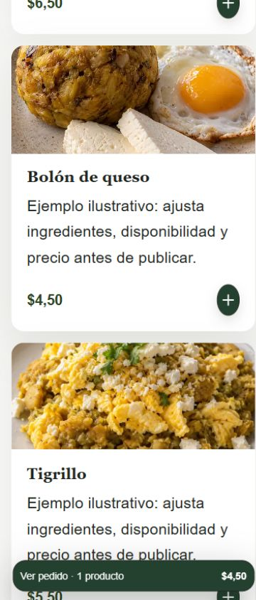
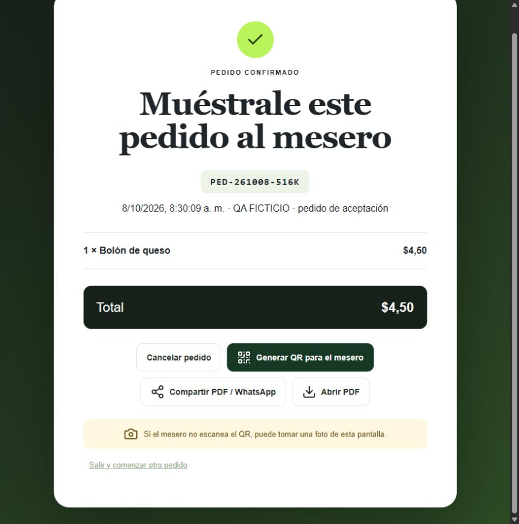

# Entrega productiva · 8 de octubre de 2026

La implementación está integrada y desplegada en la infraestructura existente. Los recorridos productivos indicados abajo funcionan con el restaurante identificado **QA FICTICIO · Octubre 2026**. No se conocen fallos críticos en el alcance comprobado. Quedan limitaciones de validación y operación explícitas; este informe no certifica cumplimiento íntegro de todos los objetivos de rendimiento o Android.

## Código y versión servida

- Repositorio íntegro: [eslay07/qr-menu-ec](https://github.com/eslay07/qr-menu-ec).
- Funcionalidades integradas por [PR 16](https://github.com/eslay07/qr-menu-ec/pull/16), commit `04884f2400ed43a99bd494d73d94f26d04cb4d4c`.
- Empaquetado y verificación MIME integrados por [PR 17](https://github.com/eslay07/qr-menu-ec/pull/17), commit `1c0ebf9f9180d85f80e9cadec4e7e7ad8e174931`.
- Versión final preparada: `7580118f-8cd4-4c15-bb03-b56fc8b808ba`, con tráfico0 durante revisión. La versión funcional anterior93dbea4d se comprobó por HTTP y navegador; la activación y verificación de contraste productivo final se registrarán tras aprobar CI.
- Plataforma: https://qr-menu-ec.consola.workers.dev . [Demostración pública comprobada](https://qa-ficticio-octubre-2026.consola.workers.dev/menu), publicación 8 al cierre de aceptación.
- Corrección final de contraste y evidencias: [PR 18](https://github.com/eslay07/qr-menu-ec/pull/18); precios, opciones y mensajes de validación usan los roles aceptados. Nueve combinaciones de paleta/plantilla verificadas por colores computados, mínimo4,5:1.
- D1 operativa y D1 histórica/imágenes conservadas; migración aditiva `0006_order_operations.sql` aplicada. Firebase Authentication/FCM conservados. Sin Blaze, R2, nuevas suscripciones o proveedor contratado.

## Cambios

Carga por ruta y módulos diferidos, solicitudes idénticas en vuelo reutilizadas, consultas independientes paralelas, lectura pública por restaurante/revisión y respuestas privadas sin caché compartida. Imágenes con dimensiones, prioridad de la principal y carga diferida del resto; filtros y totales evitan trabajo repetido.

Cinco roles de color, HEX y contraste en cliente/servidor, tres paletas, restauración explícita; categorías con ID estable y reasignación segura; nombre confirmado obligatorio antes de guardar/publicar/provisionar; direcciones legibles con colisión atómica; familias de sesión revocables por dispositivo; contador de unidades/importe; tres plantillas y texto ampliado; contacto/horarios públicos; solicitudes de WhatsApp sin pedido registrado; promociones tipadas con reglas explícitas; pedidos atómicos por identidad de operación. Se conservaron límites, permisos, precio calculado por servidor y clientes/enlaces anteriores.

## Verificaciones y evidencia

| Recorrido | Resultado productivo y alcance |
| --- | --- |
| Dueño | Inicio normal con credenciales ficticias; guardar y publicar, recargar publicación; nombre vacío produce el texto exacto y enfoca el campo antes de guardar. Los 400 API sin efectos secundarios se comprobaron en pruebas automatizadas. |
| Apariencia | Lista, compacta y tarjetas publicadas; paletas cálida, oscura y neutra; acento/acción distintos; ratios reales y aviso de contraste; restaurar/defaults mantienen acción explícita. |
| Categorías | Renombrar/ordenar mantiene `desayunos`; publicación conserva 40 productos. El borrador elimina una categoría vacía y rechaza eliminar una con platos sin reasignación. Reasignación, última categoría y concurrencia cubiertas en tests. |
| Datos públicos | Descripción ficticia, logo QA cargado de 128 px, contacto internacional temporal, enlace de llamada/direcciones, horario jueves 22:00–02:00 en America/Guayaquil. Guardar/publicar/recargar coincide; sin horarios no afirma abierto. |
| Carrito | 2 bolones + 3 tigrillos = 5 unidades y $25,50 en cabecera/barra; disminuir = 4/$20,00; eliminar y vaciar actualizan inmediatamente. |
| WhatsApp | Enlace preparado con cantidad, producto y total; modelo `request`, `registered:false`. No se abrió ni envió mensaje; número reservado ficticio retirado al cierre. |
| Pedidos | Pedido ficticio `PED-261008-516K`, $4,50, creado por UI normal. Dos POST concurrentes del mismo intento devuelven ese pedido; payload diferente devuelve 409; un solo pedido en D1. Claves distintas concurrentes comprobadas en tests. |
| Promociones | Aviso no cambia precios. Descuento explícito revalidado a $4,00; importe anterior y revisión anterior rechazan 409. Descuento temporal pausado al cierre. Vigencia, vencimiento y solapamientos cubiertos en tests; las fechas no se acreditan mediante el llenado automatizado inicial del control nativo. |
| Seguridad | Estado/pedidos/sesiones/copias/configuración privados: 401 anónimo y `no-store`. Cuenta ficticia no abre otro panel. Reportes permanecen bloqueados por sus permisos; no se ampliaron. Matriz completa de aislamiento/roles/CSRF cubierta en tests. |
| Sesiones/Android | El usuario realizó y confirmó diez cierres/reaperturas del Honor. D1 registra dos sesiones activas —teléfono y navegador—, sin acumulación de diez. Logout normal del navegador redujo a una sesión y conservó la del Honor. Captura física del panel disponible localmente. Refresh concurrente, expiración, logout, revocación y vínculo FCM cubiertos en tests. No se completó revisión visual de los nuevos ajustes Android: el usuario retiró disponibilidad del teléfono. |
| Responsive | Capturas productivas de cada plantilla a 320/360/390/768/1440 px. Compacta no desborda y la barra permanece dentro del viewport. Zoom CSS 200%: 30 combinaciones locales sin desbordamiento; no equivale a zoom real del navegador. |

[Evidencias versionadas](evidence/2026-10-08/) incluyen recibos de idempotencia, publicación/alias/QR, precios, seguridad, sesiones y capturas. Las 15 capturas de anchos productivos completas están también en `outputs/product-production-{list,cards,compact}-<ancho>.jpg` del workspace.

Tipos y build Worker aprobados. Suite completa con emulador: **168/168, cero fallos/omisiones**, más **2/2 tests de empaquetado MIME**. Reglas Firebase repetidas: 8/8. CI de los PR 16/17: build, auditoría/secretos, CodeQL y preview aprobados. Audit no tiene hallazgos altos/críticos. Smoke productivo aprobado: la automatización fue bloqueada por Turnstile, mientras el pedido anterior sí se creó en navegador mediante el flujo normal.

**Lint no aprobado**: comparativa completa registrada 420 errores/5 avisos previos y 450/5 en la entrega funcional; incluye deuda previa y hallazgos nuevos. No se desactivaron reglas ni aserciones. Los archivos nuevos de instrumentación visual pasaron lint. Logs locales bajo `outputs/`, especialmente `product-all-emulator.txt`, `product-production-smoke-final.txt`, `product-typecheck-evidence.txt` y `lint-product-release-final.txt`.

## Rendimiento

[Informe completo con mediana/rango](performance-release-2026-10-08.md): mismo perfil 390 px, CPU 4×, 1,6 Mbps/750 kbps/RTT 150 ms, catálogos ficticios 10/40, cinco cargas frías y cinco calientes por fase, veinte repeticiones por interacción. API local simulada; no representa latencia de Firebase/backend productivo ni el teléfono físico.

LCP frío antes/después: 10 productos **1,724→1,740 s**, 40 **2,020→2,064 s**; medianas dentro de 2,5 s, algunos máximos posteriores hasta 3,792 s. CLS posterior aproximadamente **0,065**. Reapertura del panel simulado: medianas **2,52/2,57 s**. Respuesta instrumentada evento→DOM→dos frames: medianas posteriores 37–85 ms; categoría40 tiene máximo326 ms. No se afirma mejora general de LCP ni cumplimiento de 200 ms en todas las muestras. Guardado/publicación con API simulada queda separado en la tabla; la confirmación real se verificó funcionalmente, sin atribuirle la latencia simulada.

## Subdominio, QR y operación

El hostname `qa-ficticio-octubre-2026.consola.workers.dev` es **un subdominio real**, provisionado en el namespace existente, con TLS y rutas 200 verificados. El [QR SVG](evidence/2026-10-08/product-public-qr.svg) se decodificó a su URL completa. `/m/qa-ficticio-octubre-2026/api/v1/menu`, `/r/76d3def9-52e9-4779-b048-1242f45c634e/api/v1/menu` y subdominio devolvieron la misma publicación 8. El evento de descarga del navegador integrado no fue observable; el SVG adjunto se extrajo del QR realmente visible, sin regenerarlo.

Turnstile incorporó el hostname ficticio reemplazando únicamente un preview histórico deshabilitado; conservó los hostnames productivos, identidad y protección. Recibo versionado. **Bloqueo de provisión automática futura:** el Worker no tiene `CLOUDFLARE_API_TOKEN` permanente con permisos mínimos de Workers; el operador pudo provisionar el ejemplo usando la autorización CLI existente. No se almacenó OAuth efímero como secreto. Además, nuevos hostnames necesitan autorización Turnstile dentro de sus cuotas. Las rutas legibles funcionan aunque ese acceso no esté configurado.

APK firmado **0.8.2/versionCode13 conservado**, sin cambios nativos ni APK nuevo anunciado. Archivo servido e instalado: SHA-256 `9832f7880bbea5cc5f06979ca1dc922da697d5273e9f747faf393b6906768b26`, 7.513.592 bytes. El Honor tenía WebView153; no se verificaron todos los recorridos visuales físicos de esta entrega.

## Respaldo, rollback y limpieza

Respaldos cifrados verificables antes de activar: `work/private-backups/2026-10-08T06-32-43.842Z-bc42b1e2` (2.140 documentos operativos) y `2026-10-08T06-32-43.850Z-2d7aa660` (D1 histórica, 16 imágenes). AES-256-GCM, clave DPAPI CurrentUser fuera de Git; descifrado desde disco/restauración SQLite en memoria con integridad, FK y checksums correctos. Restauración de aplicación/pedidos/operaciones también ensayada aisladamente; ninguna restauración de ensayo sobre producción.

Rollback compatible: `node scripts/product-release.mjs --rollback` valida candidato activo y devuelve al padre `93dbea4d-ad00-4641-97ee-a0fe35db00de` al 100%; preserva escrituras y esquema aditivo. Verificar HTML/JS/CSS, autenticación y enlaces después. No restaurar SQL antiguo sobre producción. Reversión Turnstile: configuración previa privada `work/product-release/turnstile-rollback.json`; conservar la protección y dominios reales. El subdominio ficticio puede deshabilitarse aisladamente sin tocar hostnames existentes.

La primera activación tuvo MIME incorrecto y se revirtió inmediatamente al padre; se corrigió el empaquetado, añadieron tests y verificación automática con rollback antes de la activación vigente. No se oculta ese incidente como despliegue exitoso.

La demostración permanece identificada como ficticia por petición del encargo. Teléfono/WhatsApp de ensayo retirados, descuento temporal pausado, un pedido de aceptación aislado conservado en historial; su enlace público vence a las24horas. No se enviaron mensajes, cobros ni pedidos a restaurantes reales.

Guía breve completa: [incorporar un restaurante](restaurant-onboarding.md): habilitar acceso → nombre/contacto → categorías/platos → colores/plantilla → guardar/publicar → descargar/comprobar QR → actualizar precios/disponibilidad. Antes de incorporar negocios reales, resolver acceso de provisión automática si se desea ese flujo y cerrar la validación de zoom real/Android pendiente. La preparación técnica no sustituye trámites, contratos ni cuentas comerciales.
